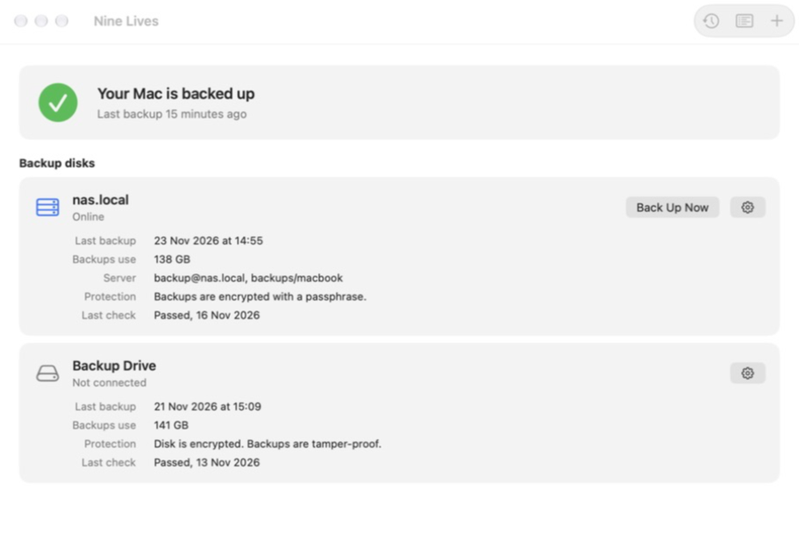

<p align="center"></p>

# Nine Lives

**Backups for your Mac that take care of themselves.**
Plug in a USB disk, or point Nine Lives at a server, and your files are backed up. If something goes wrong, you get them back.

[**Download the latest version**](https://github.com/vloothuis/nine-lives/releases/latest) · macOS 15 or later · Apple silicon and Intel · free and open source

<p align="center"></p>

Website: https://vloothuis.github.io/nine-lives

## How it works

1. Open Nine Lives and choose a backup disk, or a server you reach over SSH.
2. Leave it alone. Backups run when the disk is connected, and on a schedule for servers.
3. To get something back, open **Restore**, browse your backups by date, and restore to a folder or the original place.

Your backups are always encrypted before they leave your Mac. Nine Lives shows you a recovery passphrase to keep somewhere safe.

## Features

- Starts a backup when a known USB disk is plugged in, then notifies you and can eject the disk.
- Several rotating disks, each with its own backup.
- Network backups over SSH to any server with borg (a NAS, a rented server, a backup service). Nine Lives creates its own SSH key and shows you what to install on the server.
- Keeps hourly, daily, weekly and monthly backups, like Time Machine, and skips caches and other files you do not need.
- Checks your backups every month by restoring real files from them.
- Restore browser without extra software (no macFUSE).
- Backups stay readable with plain `borg`. A `HOW TO RESTORE.txt` is written next to them.

## Install

1. Download the `.dmg` for your Mac from the [latest release](https://github.com/vloothuis/nine-lives/releases/latest). Pick `arm64` for Apple silicon (M1 and later) or `x86_64` for Intel.
2. Open it and drag **Nine Lives** to **Applications**.
3. The app is not notarized yet, so macOS blocks it the first time. Open it once, then go to System Settings, Privacy & Security, scroll down, click **Open Anyway** and confirm. Or run `xattr -dr com.apple.quarantine "/Applications/Nine Lives.app"` in Terminal.
4. For a complete backup, give Nine Lives **Full Disk Access** in System Settings, Privacy & Security.

Versions are dates, for example `2026.11.22`. **Nine Lives, About** shows the version and build.

## Under the hood

Nine Lives is a SwiftUI menu bar app on top of [BorgBackup](https://www.borgbackup.org) 1.4, which is bundled in the download. Disk backups use `authenticated-blake2` on encrypted disks and `repokey-blake2` with a passphrase kept in your Keychain on others. Server backups always use `repokey-blake2`.

## Build from source

```bash
swift test                 # needs borg installed (brew install borgbackup)
scripts/fetch-borg.sh      # downloads and checksum-verifies the official borg binary
scripts/bundle.sh          # produces dist/Nine Lives.app
```

Set `SIGN_IDENTITY="Developer ID Application: …"` for a hardened-runtime build. Without a bundled borg the app falls back to `/opt/homebrew/bin/borg`.

- `Sources/BorgKit`: typed borg wrapper (process runner, JSON log parsing, commands).
- `Sources/NineLivesCore`: models, engine, scheduling policy, catalog, disk monitor, coordinator.
- `Sources/NineLivesApp`: SwiftUI menu bar app and window.

Releases are built by the **Release** GitHub Action (run it from the Actions tab). It builds both architectures and publishes DMGs with checksums.

The bundled borg is a single-file build that starts slowly (3 to 5 seconds per call). Use `NINELIVES_BORG` to point at a faster install. The SSH lifecycle test runs only when `NINELIVES_TEST_SSH=port:authorized_keys_file` points at a local sshd.

## Not done yet

Disk erase and encrypt helper, consistent APFS snapshots, automatic updates, notarization. `scripts/release.sh` signs, notarizes and builds a DMG but has not been run (needs a Developer ID).

## License

BSD 3-Clause. See [LICENSE](LICENSE).
